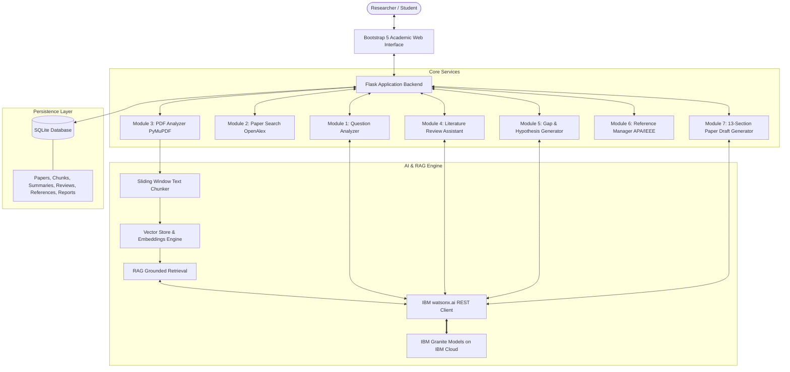
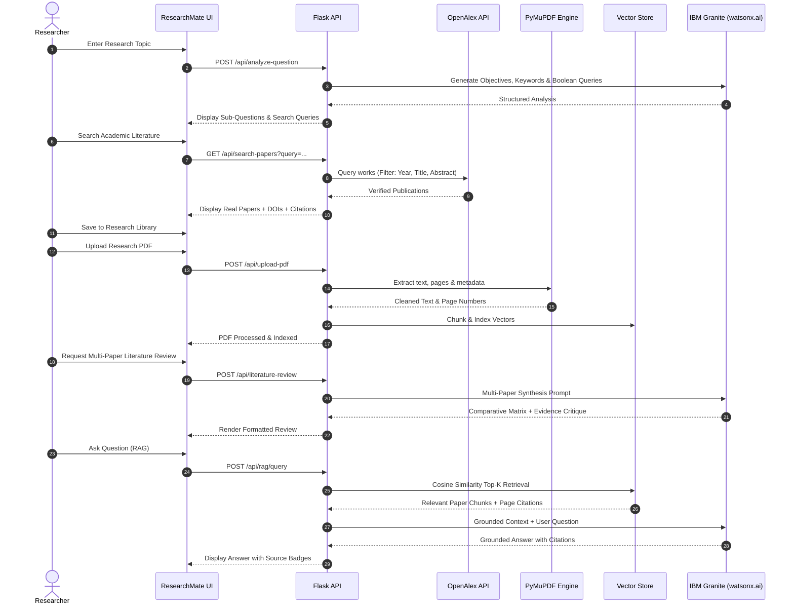

# ResearchMate – AI-Powered Research Agent
### AICTE–IBM SkillsBuild Problem Statement No. 1: Research Agent

[](https://www.python.org/)
[](https://flask.palletsprojects.com/)
[](https://www.ibm.com/granite)
[](https://pymupdf.readthedocs.io/)
[](https://www.sqlite.org/)
[](LICENSE)

---

## 1. Executive Summary & Problem Statement

**ResearchMate** is a modern, modular, full-stack AI research assistant engineered to empower students, academic researchers, and scholars to conduct literature reviews, explore empirical research gaps, summarize scholarly papers, and generate structured 13-section research drafts with rigorous academic integrity.

Built for **AICTE–IBM SkillsBuild Problem Statement No. 1: Research Agent**, ResearchMate natively integrates **IBM Granite foundation models** via **IBM watsonx.ai** and incorporates a local, high-precision **Retrieval-Augmented Generation (RAG)** pipeline.

### Core Objectives:
1. **Deconstruct Natural-Language Queries:** Automatically formulate academic sub-questions, extract primary/secondary keywords, and assemble Boolean search strings.
2. **Retrieve Legitimate Literature:** Directly query 250M+ verified peer-reviewed academic works via the **OpenAlex API** without hallucinating citations.
3. **Extract & Summarize PDFs:** Parse full-text PDFs with **PyMuPDF (`fitz`)** and generate 6-section structured summaries with IBM Granite.
4. **Synthesize Literature Reviews:** Multi-paper comparative synthesis featuring automated comparative matrices and unsupported conclusion detection.
5. **Discover Research Gaps & Hypotheses:** Pinpoint unaddressed methodological and domain constraints grounded in surveyed literature, flagged with `[REQUIRES HUMAN VERIFICATION]`.
6. **Organize References:** Automated citation formatting conforming to **APA 7th Edition**, **IEEE**, **BibTeX**, and **RIS** formats.
7. **Generate 13-Section Paper Drafts:** Formulate publication-grade IMRaD drafts distinguishing proposed vs. actual results, featuring explicit `[ORIGINAL RESEARCH REQUIRED]` markers.

---

## 2. System Architecture



### Complete End-to-End Workflow



---

## 3. Technology Stack

| Layer | Component | Technology | Description |
| :--- | :--- | :--- | :--- |
| **Frontend** | UI Framework | HTML5, CSS3, JavaScript, Bootstrap 5.3, Bootstrap Icons | Responsive academic layout, IBM Carbon color palette |
| **Backend** | Web Framework | Python 3.12, Flask 3.1, Flask-CORS | REST API endpoints, application factory pattern |
| **AI Model** | Foundation Model | **IBM Granite (`ibm/granite-13b-chat-v2`, `ibm/granite-3-8b-instruct`)** | Hosted on IBM Cloud watsonx.ai |
| **AI Integration**| SDK & API | IBM Cloud IAM OAuth2 REST Client + `ibm-watsonx-ai` SDK | Secure token refresh, timeout handling, strict schemas |
| **Document Engine**| PDF Processing | **PyMuPDF (`fitz` 1.24+)** | High-performance text, page, and metadata extraction |
| **RAG Pipeline** | Embeddings & Search | TF-IDF Sublinear Vectorizer + Cosine Similarity | Lightweight, zero-cloud-quota vector retrieval |
| **Academic API** | Paper Discovery | **OpenAlex API** | Free, open access to 250M+ verified scholarly publications |
| **Database** | Persistence | **SQLite 3 + SQLAlchemy ORM** | Stores projects, papers, chunks, summaries, reviews, references |
| **Version Control**| Source Control | Git & GitHub | Modular directory structure, `.gitignore` credential protection |

---

## 4. Main Application Modules

### Module 1: Research Question Analyzer
- Deconstructs research ideas into clear academic objectives.
- Identifies primary and secondary keywords, synonyms, and domain metrics.
- Formulates formal sub-questions (RQ1 through RQ4).
- Generates ready-to-run Boolean search queries for scholarly databases with 1-click execution.

### Module 2: Academic Paper Search (OpenAlex)
- Queries legitimate peer-reviewed works via the genuine OpenAlex API.
- Displays paper title, author list, publication year, journal venue, citation counts, inverted-index reconstructed abstracts, DOI, and open-access links.
- Supports filtering by publication year range and topic.
- **Never fabricates fake papers or phantom DOIs.**

### Module 3: Research Paper PDF Analyzer
- Accepts PDF uploads up to 32MB.
- Extracts per-page text and metadata using PyMuPDF.
- Employs IBM Granite to generate 6 academic sections:
  1. *Research Objectives*
  2. *Abstract Summary*
  3. *Methodology & System Design*
  4. *Key Findings & Empirical Results*
  5. *Limitations & Threats to Validity*
  6. *Future Research Directions*

### Module 4: Literature Review Assistant
- Selects multiple surveyed papers from the workspace library.
- Prompts IBM Granite to produce:
  - An executive thematic overview.
  - A comparative Markdown matrix table (Paper, Objective, Methodology, Key Finding, Primary Limitation).
  - Thematic synthesis across methodological trends.
  - Critical evaluation of unsupported conclusions in literature.

### Module 5: Research Gap & Hypothesis Generator
- Cross-examines limitations across all selected papers.
- Discovers empirical and methodological research voids.
- Formulates falsifiable hypotheses (H1, H2, etc.) with theoretical rationales and recommended experimental protocols.
- Explicitly flags all recommendations with `[REQUIRES HUMAN VERIFICATION]`.

### Module 6: Academic Reference Manager
- Automatically extracts bibliographic metadata from uploaded and retrieved papers.
- Supports **APA 7th Edition** and **IEEE** citation formatting.
- Formats BibTeX (`@article{...}`) and RIS (`TY  - JOUR`) bibliographic records.
- 1-click export to `.bib`, `.ris`, or formatted text files.

### Module 7: Research Report & Paper Draft Generator
Generates a complete academic research paper conforming to the 13 IMRaD sections:
1. *Title*
2. *Abstract*
3. *Keywords*
4. *Introduction*
5. *Related Work / Literature Review*
6. *Research Problem*
7. *Research Objectives*
8. *Proposed Methodology*
9. *Expected Results vs. Actual Results* (distinctly separated)
10. *Discussion*
11. *Limitations*
12. *Conclusion*
13. *References*
- Inserts `[ORIGINAL RESEARCH REQUIRED: ...]` tags for experimental measurements requiring human investigation.
- 1-click export to **Markdown (`.md`)**, **Academic HTML (`.html`)**, or **Plain Text (`.txt`)**.

---

## 5. IBM Granite & IBM Cloud Configuration Guide

ResearchMate connects directly to **IBM Granite** on **IBM watsonx.ai**.

### Step 1: Obtain IBM Cloud Credentials
1. Create a free IBM Cloud Lite account at [cloud.ibm.com/registration](https://cloud.ibm.com/registration).
2. Navigate to the watsonx console at [dataplatform.cloud.ibm.com](https://dataplatform.cloud.ibm.com/).
3. Create a Project (e.g. `ResearchMate-AICTE`).
4. Copy your **Project ID** from **Manage > General > Details**.
5. Create an IBM Cloud IAM API Key at [cloud.ibm.com/iam/apikeys](https://cloud.ibm.com/iam/apikeys).

### Step 2: Configure Environment Variables
Copy `.env.example` to `.env`:
```bash
cp .env.example .env
```
Populate `.env` with your credentials:
```ini
WATSONX_APIKEY=your_ibm_cloud_iam_api_key_here
WATSONX_PROJECT_ID=your_watsonx_project_id_here
WATSONX_URL=https://us-south.ml.cloud.ibm.com
IBM_GRANITE_MODEL_ID=ibm/granite-13b-chat-v2
```

> **Note:** Credentials can also be configured or updated dynamically through the **Settings** page in the web interface.

---

## 6. Installation & Execution Guide

### Prerequisites
- Python 3.10, 3.11, or 3.12 installed
- Git installed
- Pip package manager

### Step 1: Clone the Repository
```bash
git clone https://github.com/Darshan-yadav-45/ResearchMate.git
cd ResearchMate
```

### Step 2: Create and Activate a Virtual Environment
**On Windows (PowerShell):**
```powershell
python -m venv venv
.\venv\Scripts\Activate.ps1
```

**On Linux / macOS:**
```bash
python3 -m venv venv
source venv/bin/activate
```

### Step 3: Install Dependencies
```bash
pip install -r requirements.txt
```

### Step 4: Seed Sample Demonstration Data (Optional but Recommended)
Populate the SQLite database with 3 real research papers, 18 RAG document chunks, and pre-computed summaries:
```bash
python database/seed_demo_data.py
```

### Step 5: Run the Web Application
```bash
python app.py
```

Open your browser and navigate to:
```
http://127.0.0.1:5000
```

### Default Academic Researcher Login Credentials:
You can log in with the pre-seeded account or click the **"Quick Demo Login"** button on the login screen:
- **Username:** `researcher` *(or `researcher@ibm.aicte.edu`)*
- **Password:** `Password123!`
- *Or register a new researcher account at `/register`.*

---

## 7. Testing Instructions

ResearchMate includes a complete test suite covering all modules:

```bash
pytest tests/ -v
```

### Verified Test Suite Summary (19 Passing Tests):
- `tests/test_app_routes.py`: Verifies all 10 web routes and REST API endpoints.
- `tests/test_pdf_extractor.py`: Tests PyMuPDF document extraction, metadata retrieval, and page indexing.
- `tests/test_rag_engine.py`: Verifies sliding window chunking, TF-IDF vectorization, cosine similarity, and top-k retrieval.
- `tests/test_reference_formatter.py`: Validates APA 7th, IEEE, BibTeX, and RIS formatting rules.
- `tests/test_watsonx_client.py`: Verifies IBM IAM token authentication, error handlers, and Granite prompt schemas.

---

## 8. How to Upload Project to GitHub

Follow these exact Git commands to publish the repository to GitHub:

### Step 1: Initialize Git and Check Status
```bash
cd c:\ResearchMate
git init
git status
```

### Step 2: Stage and Commit the Files
Ensure `.gitignore` is active (prevents committing `.env`, `researchmate.db`, and uploads):
```bash
git add .
git commit -m "feat: initial commit of ResearchMate AI-Powered Research Agent (IBM Granite & watsonx.ai)"
```

### Step 3: Create a New Repository on GitHub
1. Go to [github.com/new](https://github.com/new).
2. Name the repository: `ResearchMate` (or `ResearchMate-AI-Research-Agent`).
3. Set visibility to **Public** (or **Private**).
4. Do **NOT** initialize with README or .gitignore (we already have them).
5. Click **Create repository**.

### Step 4: Link Remote and Push to GitHub
```bash
# Rename branch to main
git branch -M main

# Add your GitHub remote repository URL
git remote add origin https://github.com/Darshan-yadav-45/ResearchMate.git

# Push code to GitHub
git push -u origin main
```

### If You Make Future Updates:
```bash
git add .
git commit -m "docs: update research demonstration logs"
git push
```

---

## 9. Project Directory Structure

```
ResearchMate/
├── app.py                      # Flask Application Entry Point & Factory
├── config.py                   # Centralized Configuration & Environment Loader
├── requirements.txt            # Python Package Dependencies
├── .env.example                # Environment Variables Template
├── .gitignore                  # Git Exclusion Rules (Protects secrets & uploads)
├── README.md                   # Comprehensive Project Documentation
├── database/                   # Database Layer
│   ├── __init__.py
│   ├── db.py                   # SQLAlchemy Database Instance
│   ├── models.py               # 9 Core Database Models
│   └── seed_demo_data.py       # Demonstration Seed Script
├── ai/                         # IBM watsonx.ai & Granite Module
│   ├── __init__.py
│   ├── watsonx_client.py       # IBM IAM OAuth2 Client & Granite API Integration
│   └── prompts.py              # Academic Prompt Engineering Templates
├── rag/                        # Retrieval-Augmented Generation Engine
│   ├── __init__.py
│   ├── chunker.py              # Sliding Window Academic Text Chunker
│   ├── embeddings.py           # TF-IDF & Vector Similarity Engine
│   ├── vector_store.py         # In-Memory & Database-Backed Vector Store
│   └── rag_engine.py           # End-to-End Grounded Q&A Orchestrator
├── services/                   # Business Logic & External Integrations
│   ├── __init__.py
│   ├── paper_search.py         # OpenAlex Academic Works API Integration
│   ├── pdf_extractor.py        # PyMuPDF Document Extraction Service
│   ├── reference_formatter.py  # APA 7th, IEEE, BibTeX, and RIS Formatter
│   └── report_generator.py     # 13-Section Academic Paper Draft & Exporter
├── routes/                     # Blueprint Route Controllers
│   ├── __init__.py
│   ├── views.py                # HTML Page Rendering Routes
│   └── api.py                  # REST API Endpoints
├── templates/                  # Jinja2 HTML Templates
│   ├── base.html               # Master Layout & Sidebar Navigation
│   ├── index.html              # Dashboard & Interactive RAG Q&A
│   ├── question_analyzer.html  # Module 1: Question Analyzer
│   ├── search_papers.html      # Module 2: OpenAlex Paper Search
│   ├── analyze_pdf.html        # Module 3: PDF Upload & Summarizer
│   ├── literature_review.html  # Module 4: Literature Review Assistant
│   ├── research_gaps.html      # Module 5: Gap & Hypothesis Generator
│   ├── references.html         # Module 6: Reference Manager
│   ├── report_generator.html   # Module 7: 13-Section Paper Workspace
│   ├── history.html            # Chronological Activity History
│   └── settings.html           # IBM watsonx & Granite Configuration
├── static/                     # Frontend Static Assets
│   ├── css/
│   │   └── style.css           # Academic Theme (IBM Carbon Palette)
│   └── js/
│       └── main.js             # Client-Side Utilities & Markdown Parser
├── uploads/                    # Uploaded Research PDFs (.gitkeep)
├── exports/                    # Exported Reports (.md, .html, .txt)
└── tests/                      # Automated Test Suite (19 Tests)
    ├── __init__.py
    ├── test_app_routes.py
    ├── test_pdf_extractor.py
    ├── test_rag_engine.py
    ├── test_reference_formatter.py
    └── test_watsonx_client.py
```

---

## 10. Demonstration & Evaluation Checklist

Use this checklist during your project demonstration for the AICTE–IBM SkillsBuild review:

- [x] **IBM Granite Integration**: Dedicated AI service module calling `ibm/granite-13b-chat-v2` via IBM Cloud IAM OAuth2.
- [x] **Environment Security**: No API keys exposed in frontend or GitHub (`.gitignore` + `.env.example`).
- [x] **Clear Setup Feedback**: Informative UI banner and Settings modal when credentials are not yet entered.
- [x] **Module 1**: Natural-language question formulation, keywords, sub-questions, and Boolean queries.
- [x] **Module 2**: Genuine OpenAlex academic paper retrieval with filtering by year and DOI links.
- [x] **Module 3**: PDF upload via PyMuPDF with page-level text extraction and 6-section Granite summaries.
- [x] **Module 4**: Comparative literature review with matrix tables and unsupported conclusion warnings.
- [x] **Module 5**: Evidence-grounded research gaps and testable hypotheses labeled `[REQUIRES HUMAN VERIFICATION]`.
- [x] **Module 6**: Multi-format citation management with APA 7th, IEEE, BibTeX, and RIS export.
- [x] **Module 7**: 13-section IMRaD research paper draft with `[ORIGINAL RESEARCH REQUIRED]` placeholders.
- [x] **RAG Pipeline**: Text chunking, cosine vector similarity, grounded answers, and source citations.
- [x] **Automated Testing**: 19 automated unit and integration tests passing with `pytest`.

---

## 11. Limitations & Future Enhancements

### Limitations
1. **Scanned / OCR-only PDFs:** PDFs consisting entirely of scanned images without text layers require an OCR preprocessing pipeline (e.g. Tesseract) before PyMuPDF can extract characters.
2. **watsonx.ai Token Budgets:** Long academic documents are partitioned into sliding-window chunks to respect context window token ceilings.

### Future Enhancements
1. **Multi-Agent Debate:** Implement collaborative peer-review swarms where multiple IBM Granite agents critique drafts from author, reviewer, and editor perspectives.
2. **Direct LaTeX Compiler:** Integrate an online LaTeX compilation engine to export finalized drafts directly into IEEE and ACM camera-ready PDF formats.
3. **Graph Knowledge Explorer:** Visual interactive node graphs linking cited papers, authors, and conceptual themes.

---

## 12. References & Official Documentation

- **IBM watsonx.ai Overview:** [https://www.ibm.com/products/watsonx-ai](https://www.ibm.com/products/watsonx-ai)
- **IBM Granite Models Documentation:** [https://www.ibm.com/granite/docs/](https://www.ibm.com/granite/docs/)
- **IBM Cloud IAM API Key Management:** [https://cloud.ibm.com/docs/account?topic=account-userapikey](https://cloud.ibm.com/docs/account?topic=account-userapikey)
- **OpenAlex Academic API:** [https://docs.openalex.org/](https://docs.openalex.org/)
- **PyMuPDF Documentation:** [https://pymupdf.readthedocs.io/](https://pymupdf.readthedocs.io/)
- **AICTE–IBM SkillsBuild:** [https://skillsbuild.org/](https://skillsbuild.org/)

---

*Developed for the AICTE–IBM SkillsBuild Project Demonstration | Problem Statement No. 1: Research Agent*

